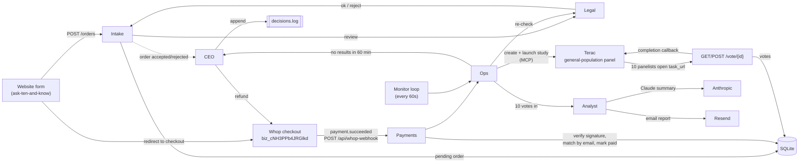

# Ask 10 Humans: Zero-Human Company

> Can't decide? 10 real people vote and tell you why, in under an hour. $9.

This is the backend for **Ask 10 Humans**, a company run entirely by AI agents. A customer submits a
question with 2–4 options and pays through **Whop**. The agents then recruit 10 people from the
general public through **Terac**, collect their votes and one-line reasons, summarize the result with
Claude, and email the report. No human employee is involved at any step.

- **Whop Business ID:** `biz_cNH3PPb4JRGlkd`
- **Stack:** FastAPI · SQLite · Terac MCP · Whop webhooks · Anthropic Claude · Resend
- **Frontend:** the [ask-ten-and-know](https://github.com/sakshiyawale/ask-ten-and-know) site posts to `POST /orders`, then redirects to Whop checkout.

## Agent architecture



### Order lifecycle

```
pending ──paid──▶ paid ──▶ launching ──▶ in_field ──10 votes──▶ completed (report emailed)
   │                │                       │
   ▼                ▼                       └──60 min, 0 votes──▶ refunded
rejected        rejected → refunded         └──60 min, some votes──▶ completed (partial)
(Legal)         (Legal, pre-launch)
```

## The agents

Each agent is one module in [`agents/`](agents/).

### Intake ([`agents/intake.py`](agents/intake.py))
`POST /orders` accepts `{email, question, options}` (2–4 options). It validates the input, asks Legal to
review the order, and stores it as `pending` (or `rejected` with a reason, returned as HTTP 422). CORS is
open to all origins so any frontend can post to it.

### Payments ([`agents/payments.py`](agents/payments.py))
`POST /api/whop-webhook` receives Whop webhooks. It verifies the signature using the
[Standard Webhooks](https://www.standardwebhooks.com) spec (`webhook-id`, `webhook-timestamp`,
`webhook-signature`, HMAC-SHA256, 5-minute replay window) with `WHOP_WEBHOOK_SECRET`. On
`payment.succeeded` it finds the buyer's email, matches the **latest pending order** for that email, marks
it `paid`, stores the Whop payment id, and hands the order to Ops. Each webhook id is processed only once.

### Ops ([`agents/ops.py`](agents/ops.py))
For each paid order, Ops asks Legal to check the question one last time. It then creates a **Terac
opportunity** through the Terac MCP server and launches it. The study goes to the general population (US
adults 18+), asks for 10 participants, and has one 2-minute task. The task's `task_url` is this app's
`/vote/{order_id}` page, where each panelist picks the best option and writes a one-line reason. On submit,
the panelist is redirected to Terac's completion callback, which marks the submission complete and pays them.
A monitor loop checks every order once a minute.

### Analyst ([`agents/analyst.py`](agents/analyst.py))
Once all 10 votes are in, the Analyst counts them in code, so the winner and vote split are always exact.
Claude then picks the **top 3 reasons** and writes a two-sentence summary. The report is saved to the
order, shown at `GET /orders/{id}`, and emailed to the buyer through **Resend**.

### CEO ([`agents/ceo.py`](agents/ceo.py))
The CEO makes the company-level decisions and appends each one as a JSON line to `decisions.log`:
- `order_accepted` / `order_rejected`: after Legal's review, at intake or before launch.
- `refund`: no results within 60 minutes. The CEO refunds the payment through the Whop API, stops the Terac study, and emails the buyer.
- `deliver_partial`: the deadline passed with some, but not all, votes in. The buyer gets a partial report.
- `price_change`: set manually through `POST /ceo/price`, or automatically when `CEO_AUTO_PRICING=true` and Terac's cost leaves less than `TARGET_MARGIN`. When auto-pricing is off, the CEO logs a `price_review` instead.

### Legal ([`agents/legal.py`](agents/legal.py))
Legal rejects orders that are hateful, sexual, violent or dangerous, that contain a private person's
personal information, or that are spam or solicitation. Claude does the review against a written policy.
A short keyword blocklist catches obvious cases and serves as the fallback if the LLM is down. Legal runs
at intake, so a bad order never becomes payable, and again right before a study launches.

## How Whop is used
- **Checkout:** the website sends buyers to a Whop checkout link for the $9 product on business `biz_cNH3PPb4JRGlkd`.
- **Webhook:** in the Whop dashboard → Developer → Webhooks, add `https://<your-render-url>/api/whop-webhook`, subscribe to `payment.succeeded`, and copy the webhook secret into `WHOP_WEBHOOK_SECRET`.
- **Matching:** the buyer's Whop email is matched to their latest `pending` order, so customers should check out with the same email they entered in the form.
- **Refunds:** the CEO calls `POST {WHOP_API_BASE}/payments/{payment_id}/refund` with `WHOP_API_KEY` when a study returns no results within 60 minutes, or when Legal blocks an order after payment.

## How Terac is used
Terac is a human-labor marketplace for AI agents. Its API is exposed as an MCP server at
`https://terac.com/api/mcp` (streamable HTTP, `Authorization: Bearer $TERAC_API_KEY`).
[`clients/terac.py`](clients/terac.py) is a small JSON-RPC client that calls these tools:

| Step | Terac MCP tool |
|---|---|
| One-time setup | `terac_create_project` ("Ask 10 Humans"; id cached in the DB, or set `TERAC_PROJECT_ID`) |
| Build the study | `terac_create_opportunity`: `num_participants: 10`, `business_type: b2c`, `unrestricted_audience: true` (general population), an English-reading screener, one `interview` task with `task_url = {PUBLIC_BASE_URL}/vote/{order_id}` and `review_type: auto_approve` |
| Go live | `terac_launch_draft_opportunity` (the customer's payment is the go-ahead; set `TERAC_AUTO_LAUNCH=false` to leave drafts for manual review in the Terac dashboard) |
| Collect | Terac adds `teracSubmissionId` and `taskId` to the task URL. `/vote` records one vote per submission, then redirects to `https://terac.com/api/external/callback` to complete it |
| Timeout | `terac_stop_opportunity` when the 60-minute deadline passes |

Your Terac organization needs enough credit to cover each study. Terac charges cost per participant × 10,
and the minimum study budget is $5.

## API

| Method | Path | Purpose |
|---|---|---|
| `GET` | `/health` | Returns `{"status": "ok"}` |
| `POST` | `/orders` | Create an order: `{email, question, options[]}` |
| `GET` | `/orders/{id}` | Order status and report (JSON; HTML in a browser, or add `?format=html`) |
| `POST` | `/api/whop-webhook` | Whop webhook receiver |
| `GET/POST` | `/vote/{id}` | Panelist voting page (the Terac task URL) |
| `GET` | `/price` | Current price |
| `POST` | `/ceo/price` | Change price (`X-Admin-Token` header) |
| `GET` | `/ceo/decisions` | Read the decisions log (`X-Admin-Token` header) |

Example:
```bash
curl -X POST $URL/orders -H 'content-type: application/json' \
  -d '{"email":"me@example.com","question":"Which name for my bakery?","options":["Rise & Shine","Crumb Club"]}'
```

## Run locally
```bash
python3 -m venv .venv && source .venv/bin/activate
pip install -r requirements-dev.txt
cp .env.example .env   # fill in keys
uvicorn main:app --reload
pytest -q              # tests stub out Terac, Whop, Resend and the LLM
```

## Deploy on Render
1. Fork or push this repo, then in Render choose **New → Blueprint** and select it (it reads [`render.yaml`](render.yaml)).
2. Fill in the secret env vars: `PUBLIC_BASE_URL` (your `https://…onrender.com` URL), `WHOP_WEBHOOK_SECRET`, `WHOP_API_KEY`, `TERAC_API_KEY`, `ANTHROPIC_API_KEY`, `RESEND_API_KEY`, `RESEND_FROM` (a sender on a domain you've verified in Resend).
3. Point the Whop webhook at `https://<your-url>/api/whop-webhook` and set the frontend's `BACKEND_URL` to your Render URL.

**Persistence:** on Render's free plan the filesystem is wiped on each deploy, which erases SQLite and
`decisions.log`. For production, attach a Render disk (see the comment in `render.yaml`) and set
`DATABASE_PATH` and `DECISIONS_LOG_PATH` to paths on it. The free plan also sleeps when idle, which pauses
the 60-second monitor loop, so use a paid instance for reliable refund timing. Run a single worker,
because the monitor loop lives in the web process.

## Environment variables
See [`.env.example`](.env.example). Key ones: `PUBLIC_BASE_URL`, `WHOP_WEBHOOK_SECRET`, `WHOP_API_KEY`,
`TERAC_API_KEY`, `ANTHROPIC_API_KEY`, `RESEND_API_KEY`, `RESEND_FROM`, `ADMIN_TOKEN`, `PRICE_USD` (9),
`REFUND_AFTER_MINUTES` (60), `PANEL_SIZE` (10), `TERAC_AUTO_LAUNCH` (true), `CEO_AUTO_PRICING` (false).
